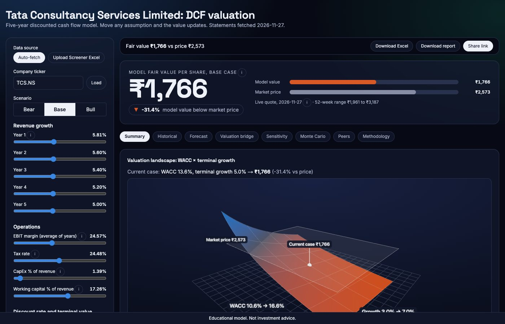
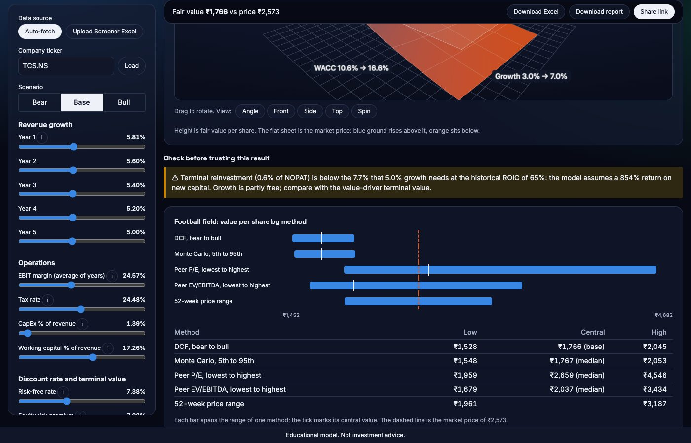
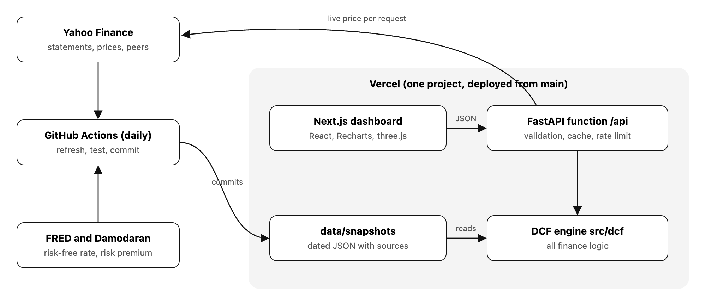

# TCS DCF Valuation App

[](https://github.com/Pravin292/Quant_Project-2/actions/workflows/ci.yml)
[](https://github.com/Pravin292/Quant_Project-2/actions/workflows/smoke.yml)
[](https://github.com/Pravin292/Quant_Project-2/actions/workflows/refresh-snapshot.yml)

A full-stack web app that values TCS (and four IT-services peers) with a five-year discounted
cash flow model, compares the result with the live share price, and lets anyone change every
assumption. Python engine, FastAPI, Next.js, one Vercel project.

**Live:** https://quant-project-2.vercel.app · **API docs:** https://quant-project-2.vercel.app/api/docs ·
**Case study:** [docs/case_study.pdf](docs/case_study.pdf)



> Educational project. Model outputs are estimates based on stated assumptions and public data,
> not investment, tax or financial advice.

## What it does

| Area | Features |
|---|---|
| Valuation | Five-year free cash flow, CAPM and WACC, regression beta, perpetuity-growth terminal value with exit-multiple and value-driver cross-checks, bridge to value per share, warnings |
| Stress tests | Bear / base / bull with editable probabilities, two sensitivity heatmaps, tornado chart, 10,000-run Monte Carlo, reverse DCF |
| Context | Historical ratios, peer P/E and EV/EBITDA, football field chart, methodology page, source and date for every default |
| Output | Excel model with live formulas, two-page PDF report, shareable link that reproduces a valuation |
| Data | Daily snapshot refresh, live price with fallback, Screener.in Excel upload |



## Architecture



```text
api/            FastAPI routes, request models, rate limit and logs (no finance logic)
src/dcf/        loader, historical, forecast, wacc, terminal, valuation, sensitivity,
                scenarios, montecarlo, peers, defaults, export, report, pdf
app/ components/ lib/   Next.js dashboard and typed API client
data/snapshots/ dated JSON statements with provenance, refreshed daily
scripts/        data refresh, latency, screenshots, diagram, case study
tests/ e2e/     pytest and Playwright
docs/           case study, verification, performance, decisions
```

Why Vercel, the snapshot design and the terminal-value method: see the decision records in [docs/adr/](docs/adr/).

## Run it locally

```bash
make install        # Python 3.12+ venv and npm packages
make run            # API on http://127.0.0.1:8000
make web            # dashboard on http://localhost:3000 (second terminal)
make check          # lint, types and tests for Python
make check-web      # lint, build and types for the frontend
```

## Assumptions and data

Money is in INR crore; defaults come from the data, never typed from memory, and each one shows
its source in the app.

| Input | Default | Source |
|---|---|---|
| Revenue growth | historical mean, fading to terminal growth | statements (Yahoo Finance) |
| EBIT margin, tax, D&A, CapEx, working capital | historical ratios | statements |
| Risk-free rate | India 10-year yield | FRED / OECD |
| Equity risk premium | India total premium | Damodaran |
| Beta | 5 years weekly vs Nifty 50, adjusted toward 1 | computed |
| Terminal growth | 5%, capped at the risk-free rate and below WACC | `config.yaml` |
| Leases | treated as debt in the bridge | modelling choice |

### Example result (snapshot of 27 Nov 2026, share price at the 26 Nov close)

| Measure | Value |
|---|---|
| Model value per share | ₹1,766 (price ₹2,640, −33.1%) |
| Bear / base / bull | ₹1,528 / ₹1,766 / ₹2,045 |
| Monte Carlo 5th to 95th percentile | ₹1,548 to ₹2,053 |
| At peer median P/E 19.5x / EV/EBITDA 9.8x | ₹2,659 / ₹2,037 |
| Revenue growth implied by the price | 18.8% a year |
| WACC, terminal share of enterprise value | 13.62%, 68% |
| Effect of one point of WACC | −₹176 (up) to +₹222 (down) |

The app shows the live price, so its upside figure differs from this table.

## Validation and testing

* 131 `pytest` tests (unit, property-based with Hypothesis, API) and 3 Playwright smoke tests on the live site.
* The hand-checkable "Chai Corner" example reproduces ₹26.8 per share.
* The exported Excel workbook, recalculated by an independent formula engine, matches Python to
  about 1e-12 relative on cash flows, values and sensitivity cells.
* Revenue, tax, net income and operating cash flow match a secondary source (S&P data via
  StockAnalysis); EBIT and CapEx differ by 0.2% to 2%. The annual report itself has **not** been
  ticked line by line: see [docs/verification.md](docs/verification.md).
* CI runs lint, type checks, tests and the production build on every push.
* `pip-audit` and `npm audit` reported no known vulnerabilities on 27 Nov 2026.

## Performance

Median API response 336 to 378 ms and p95 under 600 ms from India (20 requests per endpoint).
First request after idle: 2.1 s (one sample). Full p50 / p95 table and Lighthouse scores:
[docs/performance.md](docs/performance.md).

## Limitations

* Forecasts are uncertain; the horizon is five years and most of the value is terminal value.
* Beta and the equity risk premium are estimates that differ between sources.
* Currency effects are not modelled separately.
* Leases are debt in the bridge, so lease additions are outside CapEx; the app warns that
  reinvestment looks too low for the assumed growth.
* Yahoo Finance data can be incomplete, especially from cloud servers; the refresh job keeps the
  last good facts and refuses data that fails the tests.
* Screener upload has no payables, lease split or price history (beta starts at 1; scenario and
  Monte Carlo ranges are borrowed from TCS). It is tested on a synthetic workbook.
* The rate limit and cache are per server instance.
* Not suitable for banks or insurers. No AI annual-report explainer yet (optional milestone M17).

## Stack

Python 3.12, FastAPI, Pydantic, NumPy, openpyxl (pandas and yfinance only in the refresh job);
Next.js, React, TypeScript, Tailwind CSS, Recharts, three.js; GitHub Actions; Vercel.

## More

[SPEC.md](SPEC.md) · [CHANGELOG.md](CHANGELOG.md) · [PROGRESS.md](PROGRESS.md) ·
[final checklist](docs/final_checklist.md) · [license](LICENSE)
