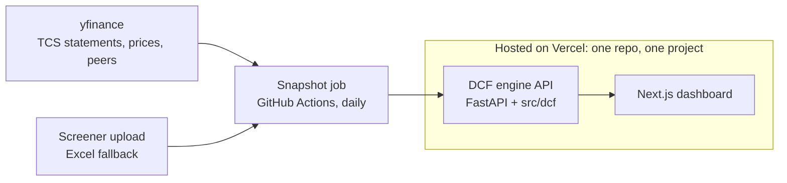

# TCS DCF Valuation App: Complete Project Document

Nov 26, 2026 · Pravin

## 1. Project overview

We are building a full-stack web app (Python valuation engine, Next.js dashboard) that values TCS shares with a 5-year Discounted Cash Flow (DCF) model, compares the result with the live market price, and lets anyone stress-test every assumption.

**Why this is portfolio-worthy:** it uses real company data, it has a rigorous validation story (every number is checked), it quantifies uncertainty (sensitivity table, scenarios, Monte Carlo), and it ships as a live demo with a clean README. That combination is what separates it from a typical student spreadsheet.

**Who it is for:** you (a beginner in finance), and the recruiters at product companies who will read your GitHub. So the code must be clean and you must be able to explain every line.

**Final deliverables**

- A live, deployed full-stack web app on Vercel (Next.js frontend, FastAPI backend)
- A GitHub repo with tests, a README and an architecture diagram
- An Excel export of the model that a finance person can audit
- A 2-page case study PDF: our TCS valuation, assumptions and limits
- A LinkedIn post and resume bullets

**Time plan:** 3 working sessions. Session 1 builds and verifies the valuation engine. Session 2 turns it into a deployed API and the core web dashboard. Session 3 adds Excel export, Monte Carlo and peer multiples, then ships with the README and case study.

## 2. Locked decisions

These are my recommended defaults, except the app and hosting choice, which you set: a full-stack app on Vercel. Change any of them before Session 1 starts; after that they are fixed.

| # | Decision | Choice | Why |
| --- | --- | --- | --- |
| 1 | Company | TCS, consolidated statements, fiscal year ends March | Asset-light, near-zero debt, stable margins: the easiest company to value correctly |
| 2 | Data source | `yfinance` (ticker `TCS.NS`) with Screener.in Excel upload as fallback; statements saved as a daily JSON snapshot so the API never depends on a slow live fetch | Auto-fetch can be incomplete or rate-limited from cloud servers; the snapshot and the upload keep the app working |
| 3 | Valuation method | FCFF DCF with perpetuity-growth terminal value; exit-multiple terminal value shown as a cross-check | Standard method, easy to explain and defend |
| 4 | App architecture | FastAPI (Python) backend that serves the engine as JSON, plus a Next.js (React + TypeScript) frontend | Finance logic stays in tested Python; the frontend makes it a real full-stack project with no "wake up" screen |
| 5 | Libraries | Backend: `pandas`, `numpy`, `yfinance`, `openpyxl`, `pydantic`, `pytest`. Frontend: Next.js, TypeScript, Tailwind CSS, Recharts | Standard, well-documented, recruiter-recognisable |
| 6 | Upgrades | Scenarios (bear / base / bull), Monte Carlo, peer-multiples cross-check; AI annual-report explainer last and optional | Each adds depth; the AI layer is the first to drop if time runs short |
| 7 | Scope | Full "Plus" scope plus the Pro extras in the priority order of section 4 | Nothing important is cut; only the order is managed |
| 8 | Hosting | GitHub + Vercel: the Next.js frontend and the Python API live in one repo and one Vercel project. Fallback: move only the API to Render or Railway if Vercel's Python size or time limits are hit (decided in milestone M9) | Free, always-on frontend, one shareable link |
| 9 | Generality | Built for TCS first, then a ticker input for other non-financial companies (Infosys, Wipro, HCLTech) | Proves the model is reusable, not hard-coded |
| 10 | Sessions | Three working sessions | The full-stack build needs one more session than a single-file app |

## 3. Finance concepts cheat sheet

A DCF values a company as the cash it will generate in future, shrunk to today's money. Keep this table open while building; each term is the plain-words version.

| Term | Simple meaning |
| --- | --- |
| Discounting | Money later is worth less than money now. ₹100 in 1 year at a 12% discount rate is 100 ÷ 1.12 = ₹89.29 today |
| Discount rate | The "shrink rate": the return you demand for the risk. Riskier business, higher rate |
| Revenue | Total sales |
| EBITDA | Revenue minus everyday running costs, before depreciation, interest and tax |
| Depreciation | Accounting cost spread over the life of a machine or building; no cash leaves that year |
| EBIT | EBITDA minus depreciation: operating profit before interest and tax |
| NOPAT | EBIT after tax: EBIT × (1 − tax rate) |
| CapEx | Cash spent on long-lasting assets (computers, buildings, equipment) |
| Working capital | Cash tied up in daily operations (unpaid customer bills, stock) minus what you owe suppliers |
| FCFF | Free cash flow to firm: cash left after running costs, tax and reinvestment, available to all investors |
| WACC | Weighted average cost of capital: our discount rate, the blended return lenders and owners expect |
| Risk-free rate | Return on a safe government bond; the baseline |
| Equity risk premium | Extra return investors demand for stocks over safe bonds |
| Beta | How much the stock moves versus the market; below 1 is calmer |
| Cost of equity | Risk-free rate + beta × equity risk premium |
| Terminal value | The value of all years after the forecast window, estimated in one step |
| Terminal growth | Assumed forever growth rate; must stay below the discount rate and below long-run economic growth |
| Enterprise value | Value of the business operations: discounted FCFF + discounted terminal value |
| Equity value | Enterprise value − debt + cash and investments − minority interest |
| Diluted shares | Shares outstanding plus shares that could be created (options) |
| Fair value per share | Equity value ÷ diluted shares; compared with the market price |
| Sensitivity analysis | A grid showing how fair value changes when two assumptions change |
| Monte Carlo | Run the model thousands of times with random assumption values to get a range of fair values |

## 4. Scope and features

Nothing is cut. Features are ordered by priority so that if time runs short, only the last items slip.

| ID | Feature | Tier | Session |
| --- | --- | --- | --- |
| F1 | Data loader: fetch TCS income statement, balance sheet, cash flow via `yfinance`; Screener Excel upload fallback; daily JSON snapshot | Must | 1 |
| F2 | Historical analysis: revenue growth, EBIT margin, tax rate, CapEx %, working-capital % for the last 3–5 years | Must | 1 |
| F3 | Forecast engine: 5-year revenue, EBIT, FCFF from editable assumptions | Must | 1 |
| F4 | WACC calculator with documented inputs (risk-free, beta, equity risk premium, cost of debt, weights) | Must | 1 |
| F5 | Terminal value (perpetuity growth) and exit-multiple cross-check | Must | 1 |
| F6 | Valuation bridge: enterprise value to equity value to fair value per share, upside versus market price | Must | 1 |
| F7 | Sensitivity table: WACC × terminal growth, and revenue growth × margin | Must | 1 |
| F8 | Automated tests and a reconciliation against a manual Excel calculation | Must | 1 |
| F9 | Web app: FastAPI backend (endpoints for historical, valuation, sensitivity, scenarios, Monte Carlo, peers, export) and a Next.js dashboard with an inputs panel and Summary, Historical, Forecast and Sensitivity tabs | Plus | 2 |
| F10 | Scenarios: bear / base / bull with one-click switch | Plus | 2 |
| F11 | Charts: FCFF bars, value waterfall (EV to equity), sensitivity heatmap | Plus | 2 |
| F12 | Excel export of the full model with live formulas | Plus | 3 |
| F13 | Ticker input to run the same model on Infosys, Wipro, HCLTech | Plus | 3 |
| F14 | Monte Carlo simulation with a distribution chart and probability of upside | Pro | 3 |
| F15 | Peer multiples cross-check (P/E, EV/EBITDA versus Infosys, Wipro, HCLTech, Tech Mahindra) | Pro | 3 |
| F16 | Deployment polish, README, architecture diagram, case study PDF | Plus | 3 |
| F17 | AI annual-report explainer: retrieves passages and explains suggested assumptions with page citations | Pro (optional) | 3, last |

**Out of scope, on purpose:** real-time trading, buy/sell signals, banks and insurers (they need different valuation methods), and any personalised investment advice.

**Advanced features:** F18 to F29 (reverse DCF, computed beta, ROIC check, football field, tornado chart and more) are listed with their priority and session in section 15.

## 5. Architecture and folder structure

The app keeps the finance logic separate from the data and the screen, so each part can be tested on its own. Data flows one way: sources to loader to engine to app.



The snapshot job keeps data fresh without slowing requests; the engine is the only place finance logic lives.

**Folder structure**

```text
Quant_Project-2/
  README.md  SPEC.md  .gitignore
  package.json           # Next.js frontend
  requirements.txt       # Python dependencies for the API
  vercel.json            # routes /api/* to the Python function
  config.yaml            # default assumptions, peer list, paths
  api/
    index.py             # FastAPI app: routes, validation, CORS
    schemas.py           # request and response models (pydantic)
  src/
    dcf/
      loader.py          # yfinance fetch + Screener upload parser
      historical.py      # growth, margins, tax rate, CapEx %, NWC %
      forecast.py        # revenue, EBIT, FCFF projection
      wacc.py            # CAPM and WACC
      terminal.py        # Gordon growth + exit multiple
      valuation.py       # EV to equity to per-share, upside
      sensitivity.py     # WACC x growth and growth x margin grids
      scenarios.py       # bear / base / bull
      montecarlo.py      # simulation
      peers.py           # peer multiples
      export.py          # Excel export
      explainer.py       # optional AI annual-report explainer
  app/                   # Next.js pages and layout
  components/            # InputsPanel, SummaryCard, FcffChart, Waterfall, Heatmap
  lib/
    api.ts               # typed client for the API
  data/
    snapshots/           # daily JSON snapshot of TCS statements
    samples/             # sample Screener export and Chai Corner test data
  scripts/
    refresh_snapshot.py  # fetches fresh data and writes the snapshot
  tests/                 # pytest: engine tests and API tests
  docs/
    architecture.png  case_study.pdf
  .github/workflows/
    refresh-snapshot.yml # daily scheduled data refresh
```

**Tech stack**

| Layer | Choice |
| --- | --- |
| Backend language | Python 3.11+ |
| API | FastAPI + Pydantic models, served as a Vercel Python function |
| Data handling | `pandas`, `numpy` |
| Market and statements data | `yfinance`; Screener.in Excel upload as fallback; daily JSON snapshot |
| Excel export | `openpyxl` |
| Backend testing | `pytest`, plus FastAPI `TestClient` for the endpoints |
| Frontend | Next.js (App Router), React, TypeScript |
| Styling | Tailwind CSS |
| Charts | Recharts (FCFF bars, waterfall, histogram); a simple custom grid for the heatmap |
| Hosting | GitHub + Vercel (one project) |
| Scheduled refresh | GitHub Actions, daily |
| Optional AI layer | PDF parser + embeddings + an LLM API, key stored as a Vercel environment variable |

**Design rules:** no finance logic inside the API routes or the frontend (routes only validate input and call `src/dcf`); no hard-coded company numbers anywhere; every function takes inputs and returns outputs with no hidden global state; each number records its source and fetch date.

**API endpoints (planned):** `GET /api/historical`, `POST /api/valuation`, `POST /api/sensitivity`, `POST /api/scenarios`, `POST /api/montecarlo`, `GET /api/peers`, `POST /api/export`. Every `POST` takes the assumptions object and returns plain JSON.

**Data flow:** a scheduled job saves a fresh JSON snapshot of the statements into the repo, which triggers a Vercel redeploy. The API reads the snapshot, runs the engine, and returns JSON; the live share price is fetched per request and falls back to the last snapshot if the fetch fails.

## 6. Inputs and data sources

The model needs six groups of inputs. Every value stored in the app must carry its source, the reporting period and the date it was fetched.

**A. Historical data (3–5 fiscal years, consolidated)**

| Input | Used for | Source |
| --- | --- | --- |
| Revenue | Forecast base, growth history | `yfinance` / Screener / annual report |
| EBITDA, EBIT | Margin history | same |
| Depreciation and amortisation | Added back in FCFF | cash flow statement |
| Capital expenditure | Reinvestment | cash flow statement |
| Receivables, payables, inventory (where reported) | Working capital | balance sheet |
| Tax expense and pre-tax profit | Effective tax rate | income statement |
| Operating cash flow | Sanity check: is profit real cash? | cash flow statement |

**B. Forecast assumptions (our judgment; all editable in the app)**

| Assumption | How we set the default |
| --- | --- |
| Revenue growth, years 1–5 | Anchored on the historical growth range, fading toward the terminal rate |
| EBIT margin, years 1–5 | Anchored on the historical range; held roughly flat |
| Tax rate | Recent effective tax rate |
| Depreciation % of revenue | Historical average |
| CapEx % of revenue | Historical average |
| Working capital % of revenue change | Historical average |

**C. Discount-rate (WACC) inputs**

| Input | Source |
| --- | --- |
| Risk-free rate (India 10-year government bond yield) | RBI or CCIL, current value at build time |
| Equity risk premium for India | Damodaran's country-risk dataset |
| Beta of TCS | Computed from 5 years of returns versus Nifty 50, cross-checked with a data provider |
| Cost of debt and debt/equity weights | Annual report (TCS carries almost no borrowings) |

**D. Terminal value inputs:** terminal growth rate (default modest and below long-run nominal economic growth), and an exit EV/EBITDA multiple for the cross-check.

**E. Balance-sheet bridge:** total debt, lease liabilities (treated consistently, see section 13), cash and cash equivalents, liquid investments, minority interest.

**F. Market data:** diluted shares outstanding, current share price, market capitalisation (for the comparison).

**Rule:** the exact current figures (bond yield, price, beta) are fetched when we build, never typed from memory.

## 7. Calculation spec

The engine computes twelve things in this exact order. Each maps to one tested function.

**Step 1. Forecast revenue.** Growth gₜ is set per year.

```latex
Revenue_t = Revenue_{t-1} \times (1 + g_t)
```

**Step 2. Forecast operating profit and after-tax profit.**

```latex
EBIT_t = Revenue_t \times EBITmargin_t \qquad NOPAT_t = EBIT_t \times (1 - taxrate)
```

**Step 3. Forecast reinvestment.** D&A and CapEx are percentages of revenue; working capital moves with the change in revenue.

```latex
\Delta NWC_t = NWC\% \times (Revenue_t - Revenue_{t-1})
```

**Step 4. Free cash flow to firm.**

```latex
FCFF_t = NOPAT_t + D\&A_t - CapEx_t - \Delta NWC_t
```

**Step 5. Cost of equity (CAPM).**

```latex
k_e = r_f + \beta \times ERP
```

**Step 6. WACC.** For TCS the debt weight is near zero, so WACC is close to the cost of equity.

```latex
WACC = \frac{E}{D+E}\,k_e + \frac{D}{D+E}\,k_d\,(1 - taxrate)
```

**Step 7. Discount each year's FCFF.** End-of-year convention by default; a mid-year toggle is an optional later addition.

```latex
PV_t = \frac{FCFF_t}{(1 + WACC)^t}
```

**Step 8. Terminal value.** Perpetuity growth (default) and exit multiple (cross-check). The model must refuse to run if terminal growth is greater than or equal to WACC.

```latex
TV = \frac{FCFF_5 \times (1+g)}{WACC - g} \qquad PV(TV) = \frac{TV}{(1+WACC)^5}
```

**Step 9. Enterprise value.**

```latex
EV = \sum_{t=1}^{5} PV_t + PV(TV)
```

**Step 10. Equity value.**

```latex
Equity = EV - Debt - Leases + Cash\&Investments - MinorityInterest
```

**Step 11. Fair value per share and upside.**

```latex
FV = \frac{Equity}{DilutedShares} \qquad Upside = \frac{FV}{Price} - 1
```

**Step 12. Sensitivity grid.** Recompute steps 7–11 across a grid of WACC values and terminal growth values; a second grid varies revenue growth and EBIT margin.

**Worked mini example** (illustrative "Chai Corner" numbers, not TCS; ₹ thousands). Use this as the first unit test.

| Year | FCFF | Discount factor at 12% | Present value |
| --- | --- | --- | --- |
| 1 | 157.5 | 1.1200 | 140.6 |
| 2 | 173.3 | 1.2544 | 138.1 |
| 3 | 190.6 | 1.4049 | 135.7 |
| 4 | 209.7 | 1.5735 | 133.3 |
| 5 | 230.6 | 1.7623 | 130.8 |

Sum of present values: 678.5. Terminal value with 4% growth: 230.6 × 1.04 ÷ (0.12 − 0.04) = 2,997.8, which discounts to 1,701.0. Enterprise value is 2,379.5. With zero debt and 300 of cash, equity is 2,679.5; over 100 shares that is 26.8 per share.

Notice the terminal value is about 71% of enterprise value. That is typical, and it is why the terminal growth and WACC assumptions get the most scrutiny.

## 8. Milestones and session plan

Session 1 produces a verified valuation engine with no UI. Session 2 turns it into a deployed API and the core dashboard. Session 3 adds the remaining features and ships. Priority A features from section 15 are slotted into these sessions as listed there. Work one milestone at a time and do not move on until its check passes.

**Before Session 1 (15 minutes, you)**

- [ ] Clone the existing (empty) repo [github.com/Pravin292/Quant\_Project-2](https://github.com/Pravin292/Quant_Project-2) and make the first commit as in section 17
- [ ] Install Python 3.11+, Node.js 20+ and VS Code (or use the Claude desktop app with a connected folder)
- [ ] Create a free Vercel account and connect it to your GitHub
- [ ] Save this document as `SPEC.md` in the repo
- [ ] Open a fresh chat or Claude Code session and give it SPEC.md first

**Session 1: the valuation engine**

| Milestone | What Claude builds | You verify |
| --- | --- | --- |
| M1 Project skeleton | Folder structure, `requirements.txt`, config file, empty modules, pytest set up | `pytest` runs (0 tests, no errors) |
| M2 Data loader (F1) | Fetch TCS statements, Screener upload parser, caching, data-quality checks | Printed tables match TCS's published annual report figures for the latest year |
| M3 Historical analysis (F2) | Growth, margins, tax rate, CapEx %, working-capital % per year | Hand-check two ratios against a calculator |
| M4 Forecast and FCFF (F3) | Five-year projection from an assumptions object | The Chai Corner example from section 7 reproduces exactly |
| M5 WACC (F4) | CAPM, WACC, with each input logged with its source | Recompute cost of equity by hand |
| M6 Terminal value and bridge (F5, F6) | Gordon growth, exit multiple, EV to equity to per-share | Chai Corner per-share value matches 26.8 |
| M7 Sensitivity (F7) | WACC × growth grid and growth × margin grid | Grid centre equals the base-case result |
| M8 Validation (F8) | Full test suite plus an Excel reconciliation sheet | All tests pass; Python and Excel agree to the rupee |

**Session 2: API and dashboard core**

| Milestone | What Claude builds | You verify |
| --- | --- | --- |
| M9 Vercel feasibility spike | A hello-world FastAPI function on Vercel that imports `numpy`, `pandas` and `yfinance`; measure bundle size, response time and first-request delay | Live URL returns JSON in a few seconds. If limits are hit, host only the API on Render or Railway; the frontend stays on Vercel |
| M10 API layer (F9) | FastAPI endpoints `/api/historical`, `/api/valuation`, `/api/sensitivity`, `/api/scenarios`; pydantic models, CORS, input validation, snapshot reader | Posting the Chai Corner inputs returns 26.8 per share; API tests pass |
| M11 Frontend shell (F9) | Next.js + TypeScript app: inputs panel, Summary, Historical and Forecast tabs, typed API client | Moving a slider updates the fair value |
| M12 Scenarios and charts (F10, F11) | Bear / base / bull switch, FCFF chart, valuation waterfall, sensitivity heatmap | Each scenario gives a sensible, different answer; deployed preview works on a phone |

**Session 3: upgrades and shipping**

| Milestone | What Claude builds | You verify |
| --- | --- | --- |
| M13 Excel export and ticker input (F12, F13) | `/api/export` downloads a workbook; ticker field runs the model on Infosys | Export opens in Excel with live formulas |
| M14 Monte Carlo (F14) | `/api/montecarlo` with 10,000 runs, histogram tab, percentile table | Median is close to the base case; response stays within the time limit |
| M15 Peer multiples (F15) | `/api/peers` and a cross-check table | Peer data timestamps shown |
| M16 Ship it (F16) | Daily snapshot GitHub Action, README, architecture diagram, case study PDF, production deploy | Live link works on your phone in a private window |
| M17 AI explainer (F17, optional) | Retrieval over the annual report with page citations | Answers cite the right page on 10 test questions |

**Time guide:** with the Priority A additions from section 15, Session 1 is about 4–5 hours, Session 2 about 5–6 hours, and Session 3 about 5–6 hours. If Session 3 runs long, M17 and the Priority B items (F24, F25, F26, F29) move to an optional Session 4.

## 9. Testing and validation

A valuation app is only credible if its numbers are right, so testing is a first-class deliverable, not an afterthought.

**Unit tests (pytest), one group per module**

| Module | What the tests prove |
| --- | --- |
| Forecast | Chai Corner example reproduces FCFF of 157.5, 173.3, 190.6, 209.7, 230.6 |
| Discounting | ₹100 in 1, 2, 3 years at 12% gives 89.29, 79.72, 71.18 |
| WACC | With zero debt, WACC equals cost of equity |
| Terminal value | Raises a clear error when terminal growth is greater than or equal to WACC |
| Bridge | Debt lowers and cash raises equity value by exactly their amounts |
| Sensitivity | Centre cell of the grid equals the base-case fair value |
| Data loader | Handles missing fields, negative values and an empty response without crashing |

**Reconciliation checks**

1. Build the same model in an Excel sheet and confirm Python matches it to the rupee.
2. Compare loaded financials against TCS's annual report for the latest year.
3. Confirm FCFF is in a plausible range against reported operating cash flow.

**Sanity checks the app runs on every valuation and shows as warnings**

- Terminal value share of enterprise value above about 75% (flag it)
- Terminal growth above long-run economic growth
- Forecast EBIT margin outside the historical range by a wide gap
- WACC outside a plausible band
- Fair value more than about 2× or less than about half of the market price (check assumptions before trusting it)

**Definition of done for the engine:** all tests green, Excel reconciliation matches, every input shows its source and date, and no hard-coded company numbers exist in the code.

**API and frontend checks**

- Every endpoint is tested with FastAPI's `TestClient`: valid input returns the expected numbers; invalid input (negative shares, growth ≥ WACC) returns a clear 4xx error message
- The Chai Corner inputs posted to `/api/valuation` return 26.8 per share
- Response time of each endpoint is measured on the deployed Vercel URL, including the first request after idle
- Frontend: a manual check that every slider, scenario switch and tab updates the numbers, plus a phone-width check

## 10. UI specification

The app is a single-page Next.js dashboard with an inputs panel (a side panel on desktop, a collapsible drawer on mobile) and tabs for outputs. A visitor should understand the valuation within 10 seconds of opening it.

**Inputs panel**

- Company ticker (default `TCS.NS`)
- Data source toggle: auto-fetch or upload Screener Excel
- Scenario selector: bear / base / bull
- Sliders: revenue growth per year, EBIT margin, tax rate, CapEx %, working-capital %
- Sliders: risk-free rate, equity risk premium, beta, terminal growth
- Toggle: end-of-year or mid-year discounting

**Tabs (outputs)**

| Tab | Shows |
| --- | --- |
| Summary | Fair value per share against the live price, upside %, a verdict-style label ("model value above / below market price"), the warnings from section 9, and the headline assumptions |
| Historical | 3–5 years of revenue, margins, tax rate, CapEx %, with charts |
| Forecast | The 5-year FCFF table and bar chart; every row editable |
| Valuation bridge | Waterfall from PV of cash flows and PV of terminal value to enterprise value to equity value to per-share |
| Sensitivity | Heatmap of fair value over WACC × terminal growth; second heatmap over revenue growth × margin |
| Monte Carlo | Histogram of fair values, 5th / 50th / 95th percentiles, probability that fair value exceeds the price |
| Peers | Cross-check table of P/E and EV/EBITDA versus peers, with fetch timestamps |
| AI explainer (optional) | Ask a question about the annual report; answer with page citations |

**UX rules**

- Every number shows its unit (₹ crore, %, per share) and, on hover, its source and date
- A permanent footer: "Educational model. Not investment advice."
- Errors are plain sentences ("Terminal growth must be lower than WACC"), never stack traces
- Works on a phone-width screen; sliders are debounced so the API is called once the user stops moving them, with loading skeletons while it responds

## 11. Upgrades: Monte Carlo, peer multiples, AI explainer

Three upgrades turn a good model into a standout project. They are built in this order.

**11.1 Monte Carlo simulation (F14)**

Instead of one fair value, run the model 10,000 times with assumptions drawn from ranges, and report the spread.

- Random inputs: revenue growth, EBIT margin, WACC, terminal growth, each drawn from a triangular or normal distribution centred on the base case, with ranges tied to the historical spread
- Constraint: discard or resample any draw where terminal growth is greater than or equal to WACC
- Fixed random seed so results are reproducible
- Outputs: histogram, 5th / 25th / 50th / 75th / 95th percentiles, and the share of runs where fair value exceeds the market price
- Vectorised with `numpy` so 10,000 runs finish in about a second
- Honest caveat shown in the UI: the output is only as good as the input ranges

**11.2 Peer multiples cross-check (F15)**

A DCF depends on our forecasts; peer multiples depend on what the market pays for similar companies. Showing both is a sanity check.

- Peers: Infosys, Wipro, HCLTech, Tech Mahindra
- Metrics: P/E and EV/EBITDA
- Output: the value per share TCS would have at the peer median multiple, next to the DCF value
- Every figure is timestamped; peers differ in size and growth, which the UI states

**11.3 AI annual-report explainer (F17, optional)**

An assistant that reads TCS's annual report and explains suggested assumptions, always citing the page.

1. Download the annual report PDF and split it into passages with page numbers
2. Index the passages for retrieval (embeddings plus a vector index, or plain keyword search for the first version)
3. For a question such as "What growth does management guide for?", retrieve the best passages and have an LLM answer only from them
4. Show the answer with page citations; if nothing relevant is found, say so instead of guessing
5. Evaluate it: write 20 questions with known answers and measure how often the cited page is correct

This needs an LLM API key stored as a secret, never committed to GitHub. It is the first thing to drop if time runs short; the project is complete without it.

## 12. Deployment, GitHub and portfolio delivery

Shipping is half the value: a live link and a clear README are what recruiters actually open.

**Deployment steps**

1. Push the repo to GitHub with a `.gitignore` that excludes secrets, caches, `node_modules` and virtual environments
2. Pin Python dependencies in `requirements.txt` and JavaScript dependencies in `package.json`
3. Import the repo into Vercel, confirm the framework is detected as Next.js, and confirm the Python API under `api/` is deployed
4. Add any secrets (for example an LLM API key) as Vercel environment variables, never in the repo
5. Enable the GitHub Action that refreshes the data snapshot daily and commits it, so Vercel redeploys with fresh data
6. Test the live link on a phone and in a private window, and note the time of the first API request after idle
7. Add the live link and a screenshot to the README; optionally attach a custom domain

**README contents**

- One-paragraph pitch and a screenshot or short GIF
- Live demo link
- What the model does, in plain words
- Architecture diagram and folder structure
- How to run locally (3–5 commands)
- Assumptions, data sources, validation results, and limitations
- Tech stack and a section on testing
- Disclaimer: educational, not investment advice

**Case study PDF (2 pages)**

1. Page 1: what DCF is, our TCS assumptions and why, the fair-value result with the sensitivity heatmap
2. Page 2: Monte Carlo range, peer cross-check, limitations, and what we would improve next

**LinkedIn post outline**

- Hook: one finding from the model (for example, how much the answer moves when WACC moves by one point)
- What you built and the stack
- One thing you learned
- Live link and GitHub link

**GitHub hygiene:** meaningful commit messages after every milestone, a tagged `v1.0` release, and the repo pinned on your profile.

## 13. Risks, limitations and defending your assumptions

A DCF is an estimate, not a prediction. The project is strongest when it shows you know exactly where the estimate can go wrong.

| Risk | Mitigation |
| --- | --- |
| `yfinance` data is incomplete or changes format | Screener Excel upload fallback, daily snapshot, data-quality checks that stop the run with a clear message |
| `yfinance` is blocked or rate-limited from shared cloud servers | The API reads the daily snapshot first; only the live share price is fetched per request, with a fallback to the last snapshot |
| Vercel Python limits (bundle size, run time, first-request delay) | Feasibility spike in milestone M9; keep dependencies lean; vectorised Monte Carlo; fallback is hosting only the API on Render or Railway |
| Terminal value dominates the result (often 70%+) | Show its share, show the sensitivity grid, cross-check with an exit multiple and peer multiples |
| Terminal growth set too close to WACC explodes the value | Hard validation: refuse when growth ≥ WACC; warn above long-run economic growth |
| Lease liabilities counted twice or not at all | Pick one treatment and document it: either treat lease liabilities as debt in the bridge (and exclude lease payments from operating costs), or keep leases as an operating cost and exclude them from debt. State the choice in the README |
| Cash and investments mis-counted | Include cash plus liquid investments in the bridge; list each line used |
| Currency effects (USD earnings, ₹ reporting) not modelled | Stated as a limitation; growth scenarios reflect a range of currency outcomes |
| Beta and risk premium are estimates that vary by source | Show the inputs, let the user change them, and display sensitivity to WACC |
| Share count changes from buybacks | Use the latest diluted count and show its date |
| Garbage in, garbage out on forecasts | Anchor defaults on history; every override is visible and logged |
| Looking like investment advice | Permanent disclaimer; wording is "model value", never "buy" or "sell" |

**How to defend your assumptions in an interview**

1. Start from history: "Revenue growth averaged X% over 5 years, so my base case fades from there."
2. Explain why you chose each driver and show the sensitivity: "If WACC moves one point, value moves Y%."
3. Admit the weak spot first: "Terminal value is about 70% of the result, so I tested it three ways."
4. Show validation: tests, Excel reconciliation, and peer cross-check.
5. Be clear about scope: a non-financial company, a 5-year horizon, and an educational purpose.

**Disclaimer used in the app and README:** This is an educational project. Model outputs are estimates based on stated assumptions and public data, not investment, tax or financial advice.

## 14. Resume bullets, interview prep and prompts for Claude

**14.1 Resume bullets (fill the brackets with your real measured numbers; never invent results)**

- Built and deployed a full-stack DCF valuation app for TCS (Next.js, FastAPI, Python) on Vercel with a 5-year FCFF model, WACC calculator and terminal-value cross-checks; live at \[link\]
- Wrote \[N\] unit tests and reconciled model output to an independent Excel build, matching to \[precision\]
- Implemented a \[10,000\]-run Monte Carlo simulation (vectorised NumPy) to express fair value as a probability range rather than a point estimate
- Added peer-multiple cross-checks against \[N\] IT-services companies and a sensitivity heatmap over WACC and terminal growth
- (Optional) Built a retrieval-based annual-report assistant with page-level citations, evaluated on \[N\] questions at \[X\]% citation accuracy

**14.2 Interview questions you should be able to answer**

| Question | Core of a good answer |
| --- | --- |
| Why FCFF and not net profit? | Profit includes non-cash items; FCFF is the real cash available to all investors before financing choices |
| Why discount at WACC? | It is the blended return required by lenders and owners, matching the risk of the cash flows |
| What drives the result most? | Terminal value, WACC and terminal growth; I tested them with a sensitivity grid |
| Why is terminal growth capped? | A company cannot outgrow the economy forever, and growth near WACC makes the formula blow up |
| How did you validate it? | Unit tests, an independent Excel rebuild, annual-report reconciliation, peer cross-check |
| What are the model's limits? | Forecast uncertainty, estimated beta and risk premium, currency effects, 5-year horizon |
| How would you extend it? | More companies, a banks-specific model, scenario probabilities, automated report parsing |

**14.3 Prompts to give Claude at each stage**

Always start a session with: "Here is SPEC.md. Read it fully. We will build one milestone at a time. After each milestone, explain what you built in simple words and tell me how to verify it."

| Milestone | Prompt |
| --- | --- |
| M1 | "Implement milestone M1: create the folder structure from section 5, requirements.txt, a config file, and an empty pytest setup. Explain each file." |
| M2 | "Implement M2: the data loader for TCS.NS using yfinance with a Screener Excel upload fallback, a JSON snapshot, and data-quality checks. Print the tables so I can compare them with the annual report." |
| M3 | "Implement M3: historical ratios. Show the formulas in comments and a table of results." |
| M4 | "Implement M4: the forecast and FCFF functions. Write a test using the Chai Corner example in section 7 and make it pass." |
| M5–M6 | "Implement WACC, terminal value and the valuation bridge exactly per section 7, with tests, including the error when growth is greater than or equal to WACC." |
| M7–M8 | "Implement the sensitivity grids, then the full test suite and an Excel reconciliation sheet. Tell me how to compare it by hand." |
| M9 | "Create a minimal FastAPI function on Vercel that imports numpy, pandas and yfinance. Deploy it, and report the bundle size, response time and first-request delay. If it is too slow or too large, propose the fallback from section 2." |
| M10 | "Implement the FastAPI endpoints from section 5 with pydantic models, validation and tests. The Chai Corner input must return 26.8 per share." |
| M11 | "Create the Next.js and TypeScript frontend with the inputs panel and the Summary, Historical and Forecast tabs, using a typed API client." |
| M12 | "Add the scenario switch, FCFF chart, valuation waterfall and sensitivity heatmap, then deploy a preview." |
| M13 | "Add the Excel export endpoint and a ticker input, and test it with Infosys." |
| M14 | "Implement the Monte Carlo endpoint per section 11.1 with a fixed seed, and a histogram tab." |
| M15 | "Implement the peer multiples endpoint per section 11.2 with timestamps, and a Peers tab." |
| M16 | "Write the README, the architecture diagram, the daily snapshot GitHub Action, and the production deployment steps for Vercel." |
| Any time | "Explain this code like I'm a beginner, then ask me two questions to check I understood it." |

**Working rules:** one milestone per message; run every piece of code yourself; paste errors back as they are; commit to GitHub after each milestone; and if a chat grows long, start a new one with SPEC.md plus your current code.

## 15. Advanced additions

These twelve features are what turn a solid student DCF into a project that looks like professional equity-research tooling. Priority A items are the ones I would not skip; B items are extras that fit if time allows.

| ID | Feature | In plain words | Why it impresses | Priority | Session |
| --- | --- | --- | --- | --- | --- |
| F18 | Reverse DCF | Instead of asking "what is TCS worth?", ask "what growth is today's share price already assuming?". The app solves for the growth rate that makes fair value equal the market price | Shows you can read market expectations with a DCF, a technique professional investors use | A | 3 |
| F19 | Beta computed by regression | Calculate TCS's beta from 5 years of weekly returns versus the Nifty 50 (ordinary least squares), show the confidence range, and apply the standard adjustment toward 1 | Replaces a typed-in number with one you computed and can explain | A | 1 (inside M5) |
| F20 | Value-creation check (ROIC vs WACC) | Growing forever costs money: reinvestment rate = terminal growth ÷ return on invested capital (ROIC). The app checks that the terminal ROIC is plausible instead of letting growth come free | Catches the most common DCF mistake and shows real valuation maturity | A | 1 (inside M6) |
| F21 | Football field chart | One chart of horizontal bars: DCF (bear to bull), Monte Carlo 5th to 95th percentile, peer P/E value, peer EV/EBITDA value, 52-week price range, with today's price as a vertical line | The standard summary exhibit in investment banking and research | A | 3 |
| F22 | Tornado chart | Move each assumption by one point and rank which moves fair value most | Shows the model's true drivers at a glance | A | 2 |
| F23 | Shareable assumptions link | All assumptions are stored in the page URL, so a link reproduces the exact valuation | Real product thinking; easy to share with recruiters | A | 2 |
| F24 | Methodology tab | A plain-language page in the app explaining every formula, source and limitation | Transparency, and good interview rehearsal | B | 2 |
| F25 | PDF valuation report | A "Download report" button creates a 2-page PDF: summary, assumptions, sensitivity, caveats | A professional deliverable | B | 3 |
| F26 | Probability-weighted scenarios | Give bear / base / bull probabilities (editable) and compute the expected fair value | Connects scenarios to decisions | B | 3 |
| F27 | Property-based tests | With the `hypothesis` library, test rules that must always hold: a higher WACC never raises value, higher growth never lowers it, the bridge always adds up, and random valid inputs never crash the engine | Advanced testing that few student projects have | A | 1–2 |
| F28 | Performance and observability | Response caching, structured request logs, input bounds, light rate limiting, and a README table of p50 / p95 response times per endpoint | Production thinking and measurable numbers for your resume | A | 3 |
| F29 | End-to-end smoke test | A Playwright test that opens the deployed app, moves a slider and checks the fair value changes | Proves the whole stack works after every deploy | B | 3 |

**How reverse DCF works (simple version).** The model already turns growth into a fair value. Reverse DCF runs it backwards: try a growth rate, see the fair value, adjust, and repeat (bisection) until the fair value equals the current price. The growth rate that matches is "what the market is pricing in". If it is far above TCS's history, the price looks demanding; if below, it looks undemanding. It must be tested with a case where the answer is known.

**Honest note on scale.** All twelve add roughly one extra working session. The plan in section 8 stays at three sessions for the core; Priority A items are placed inside those sessions as listed above, and Priority B items move to an optional Session 4 if time runs short.

## 16. Engineering quality bar

Recruiters at product companies judge a repo by how it is built, not only what it does. These standards apply from the first commit.

| Area | Standard |
| --- | --- |
| Continuous integration | A GitHub Actions workflow runs on every push and pull request: `pytest`, `ruff` (lint) and `mypy` (types) for Python; ESLint, TypeScript type-check and `next build` for the frontend. A green status badge sits at the top of the README |
| Code style | Type hints on every Python function; a docstring for each finance function stating the formula and units; `ruff` + `black` formatting; pre-commit hooks so bad formatting never reaches Git |
| Git workflow | `main` is always deployable. One short branch per milestone (for example `m04-forecast`), merged by pull request with a short checklist. Vercel creates a preview link for each pull request |
| Commit messages | Conventional style: `feat:`, `fix:`, `test:`, `docs:`, `refactor:`, with a clear one-line summary |
| Configuration | Defaults in `config.yaml`; secrets only in environment variables; a committed `.env.example` listing the names but not the values |
| Error handling | Custom exceptions (for example `InvalidAssumptionError`, `DataUnavailableError`) mapped to clear 422 / 503 API responses with plain-language messages |
| Reproducibility | Pinned dependency versions, fixed random seeds, dated data snapshots, and one-command scripts (`make test`, `make run`) |
| Security | Input bounds on every assumption (for example revenue growth between −20% and 40%), CORS limited to the site's own domain, no secrets in frontend code, a dependency audit before release |
| Accessibility and speed | Keyboard-navigable controls, colour-blind-safe chart colours, readable contrast, a Lighthouse check with the scores noted in the README |
| Documentation | README, SPEC.md, a CHANGELOG, and short Architecture Decision Records (one page each) explaining why: Vercel, the snapshot design, the terminal-value method |
| API documentation | FastAPI generates interactive API docs automatically; link them from the README |

**Why this matters for you:** each row is something an interviewer can ask about, and each one produces something visible in the repo (a badge, a workflow file, a test report) that proves it.

## 17. Repository setup and Git workflow

The project lives at [github.com/Pravin292/Quant\_Project-2](https://github.com/Pravin292/Quant_Project-2). It is currently empty: no files and no commits, so we start from a clean slate and the repo name stays `Quant_Project-2`.

**Day-0 setup (about 20 minutes)**

1. Clone the repo and enter it
2. Add `SPEC.md` (export this document), a README stub, `.gitignore`, `.env.example` and a `LICENSE` (MIT is a safe default)
3. Make the first commit on `main` with the message `docs: add project spec` and push
4. Protect `main` (optional): require the CI check to pass before merging
5. At milestone M9, import the repo into Vercel with the repo root as the project root

```bash
git clone https://github.com/Pravin292/Quant_Project-2.git
cd Quant_Project-2
# add SPEC.md, README.md, .gitignore, .env.example, LICENSE
git add .
git commit -m "docs: add project spec"
git push -u origin main
```

**What `.gitignore` must exclude:** `.env`, `__pycache__/`, `.venv/`, `node_modules/`, `.next/`, `.vercel/`, `.pytest_cache/`, `.mypy_cache/`, and any local data cache. The daily JSON snapshot in `data/snapshots/` is the one data folder that is committed on purpose.

**Branch and commit rhythm**

| Milestone | Branch name | Example commit message |
| --- | --- | --- |
| M1 | `m01-skeleton` | `chore: add project skeleton and CI` |
| M2 | `m02-loader` | `feat: load TCS statements and snapshot` |
| M4 | `m04-forecast` | `feat: forecast revenue and FCFF` |
| M6 | `m06-valuation` | `feat: terminal value and valuation bridge` |
| M10 | `m10-api` | `feat: add FastAPI valuation endpoints` |
| M16 | `m16-ship` | `docs: README, diagram, case study` |

**Repository polish (do at M16):** a one-line description, topics (`python`, `fastapi`, `nextjs`, `dcf`, `valuation`, `finance`), the live link in the About box, a `v1.0` release with notes, and the repo pinned on your GitHub profile.

## 18. Final acceptance checklist

The project counts as finished only when every box below is ticked. Anything unticked is either a known, documented limitation or still to do.

**Valuation engine**

- [ ] Chai Corner example reproduces 26.8 per share exactly
- [ ] TCS valuation runs end to end from the snapshot, with every input showing source and date
- [ ] Python output matches an independent Excel rebuild
- [ ] Beta is computed by regression, and the ROIC reinvestment check runs
- [ ] Reverse DCF returns the growth rate implied by the market price

**Testing and quality**

- [ ] All unit, property-based and API tests pass
- [ ] CI is green on `main` and the badge shows in the README
- [ ] Type-check, lint and `next build` pass with no errors

**Web app**

- [ ] Inputs panel, Summary, Historical, Forecast, Sensitivity, Scenarios, Monte Carlo and Peers tabs all work
- [ ] Waterfall, FCFF chart, heatmap, tornado chart and football field chart render correctly
- [ ] Shareable link reproduces an exact valuation
- [ ] Works on a phone and shows clear messages for bad inputs
- [ ] Excel export opens with live formulas

**Deployment**

- [ ] Live Vercel link works in a private window, with the first-request time noted
- [ ] Daily snapshot Action runs and redeploys
- [ ] README has the live link, screenshots, architecture diagram, assumptions, validation results, limitations and the p50 / p95 timing table

**Portfolio and interview readiness**

- [ ] 2-page case study PDF and LinkedIn post are written
- [ ] `v1.0` release is tagged and the repo is pinned on your profile
- [ ] Resume bullets use real, measured numbers
- [ ] You can explain every formula in section 7 without notes and answer all questions in section 14.2

**Documented limitations (always include):** forecast uncertainty, estimated risk premium, currency effects, a 5-year horizon, and an educational purpose that is not investment advice.
